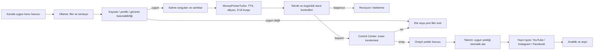
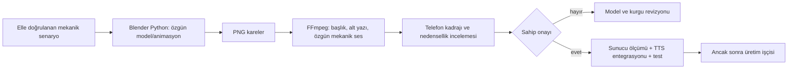

# BuiltWhys Shorts Factory — mimari ve karar akışı

> 25 Ekim 2026: Bu belge yerel kaynak kodu açıklar; canlı sunucunun o andaki durumu doğrulanmış sayılmaz. Yeni 3D pilotlar mevcut üretim/yayın hattına bağlı değildir.

## Bugünkü üretim hattı

MoneyPrinterTurbo tabanı üzerine eklenen BuiltWhys otomasyonu; konu seçimi, stok görüntü ve özgün diyagram, senaryo, İngilizce seslendirme, altyazı, inceleme, takvim ve yayımlama aşamalarından oluşur.

**Önemli sınır:** Kodda `allow_unapproved_fallback=false` varsayılandır. `auto_assign()` yalnızca `status=approved`, `human_reviewed=1`, politika kontrolünden geçmiş videoları seçer. Yayın işçisi teknik kaliteyi, insan incelemesini, paneldeki ve ortam değişkenindeki yayın kilitlerini yeniden kontrol eder. Dolayısıyla sistemin onaysız videoları otomatik yayımladığı iddia edilmemelidir; onaylı havuz tükenebilir.

| Bileşen | Gerçek görev | Kaynak |
| --- | --- | --- |
| Fikir | Kanal sözleşmesi, doğrulanmış konu listesi; Ollama `qwen3:4b` varsayılanı | `automation/channel_catalog.json`, `automation/candidate_planner.py` |
| Fikir puanı | Kanal uyumu, Wikipedia araştırma izi, Pexels bulunabilirliği, yenilik ve kanca | `automation/candidate_planner.py` |
| Senaryo ve revizyon | Yerel modelden JSON; sahne sorguları ve stok arama planı | `automation/producer_worker.py` |
| Görseller | Stok klipler + projede çizilen açıklayıcı diyagramlar | `automation/generate_pexels_batch.py`, `automation/producer_worker.py` |
| Ses ve kurgu | Varsayılan İngilizce `en-US-AndrewMultilingualNeural`, altyazı, dikey kurgu | `automation/render_job.py` → MoneyPrinterTurbo API |
| Özgünlük kanıtı | Kaynak/lisans kayıtları, varlık tekrarı, başlık/metin benzerliği | `automation/originality.py` |
| Teknik kontrol | Video okunurluğu, 1080×1920, 30–60 sn, ses izi, metin/meta veri | `automation/production_quality.py` |
| İnceleme/yayın | Onay, ret, revizyon, yedek, takvim, üç platform | `automation/control_center_store.py`, `automation/scheduler_worker.py`, `automation/publisher_worker.py` |

Bu puanlar **izlenme veya para kazanma tahmini değildir**. Özgünlük puanı belgelenebilir kanıtı, teknik puan dosya/metin kurallarını ölçer. Bir görselin güzel, konuyla tam uyumlu veya mekanik olarak doğru olduğunu garanti etmez. Ekrandaki `100/100`, YouTube para kazanma kabulü anlamına gelmez.

## Sunucu ve veri sınırları

`deploy/bootstrap-ubuntu.sh` Ubuntu için Docker/Compose, UFW ve fail2ban hazırlar. `docker-compose.production.yml` API, Control Center, Ollama, üretim, takvim, yayın, analitik, Drive arşiv, yedek, sağlık izleme ve Caddy servislerini tanımlar. `deploy/deploy.sh` ön kontrol, derleme, başlatma ve sağlık kontrolü yapar. `storage/` kalıcı disk olarak bağlanır; Ollama/Caddy için ayrı Docker volume'leri vardır. Geçmiş kurulumun sağlayıcısı Hetzner Cloud, alan adı `builtwhys.space` idi; makine tipi ve canlı durum bu incelemede doğrulanmadı.

**Güvenlik:** IP, SSH özel anahtarı, tokenlar, parolalar, gerçek `.env.automation`, `config.toml`, OAuth dosyaları, veritabanı ve medya arşivi GitHub'a konmaz. `PUBLISH_ENABLED` ve paneldeki `publishing_enabled` iki ayrı yayın kilididir; mevcut değerleri burada belgelenmez.

## Ayrı 3D pilot hattı

`automation/pilots_3d/lock_story.py` ilk basit kilit denemesidir. `lock_realistic_story.py` daha ayrıntılı ikinci modeldir. İkinci pilot **hâlâ** anahtar girişinin her pimi nasıl kaldırdığını kesintisiz, açık biçimde göstermiyor. Pilot 24 sn / 720×1280 ve konuşmasızdır; mevcut 30–60 sn / 1080×1920 teslim kurallarını karşılayan yayın adayı değildir. Mevcut üretim/yayın işçisine bağlanmadı.

## Lisans ve yeniden üretilebilirlik

Taban [MoneyPrinterTurbo](https://github.com/harry0703/MoneyPrinterTurbo) MIT lisanslıdır; `LICENSE` ve atıf korunur. Pilot geometri/metin/mekanik sesleri proje içinde oluşturuldu. Referans üreticinin görüntü, ses, müzik veya markası kopyalanmaz. Harici stok/model eklendiğinde kaynak URL'si, lisans ve ticari kullanım kaydı gerekir.

3D otomasyonu canlıya almadan önce: doğrulanmış model/rig, sahne başına olay kontrolü, özgün İngilizce TTS, konuşma–görüntü eşleşmesi, son MP4 kare incelemesi, sunucu CPU/RAM ölçümü, hata tekrar denemesi ve eski hattı koruyan özellik bayrağı gerekir.
