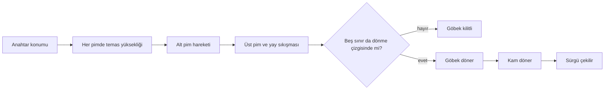

# Kilit videosu v3 — izleyicinin mekanizmayı gerçekten anlaması için

> Bu belge henüz bir video veya canlı üretim entegrasyonu değildir. İkinci pilotun kaynak kodundaki görsel ve fiziksel kopuklukları kapatmak için üretim şartnamesidir.

## İkinci pilotta tespit edilen somut hata

`automation/pilots_3d/lock_realistic_story.py` içinde anahtar ilerleyişi ve pimler ayrı keyframe dizileriyle hareket ediyor. Pimlerin hedef konumu `start + (inserted-start) * (i+1)/6` zaman hesabıyla belirleniyor; anahtar dişinin o pimle temasından türetilmiyor. Bu yüzden hareketin nedeni görünmüyor. Yaylar modellenmiş ama sıkışma hareketi yok. Ön yüz, kesit ve sürgü ayrı sahne yerleşimlerinde; izleyici aynı kilidi takip ettiğini kolayca anlayamıyor. Kam ile sürgü de birbirine fiziksel/kinematik bağlı değil; ikisi ayrı keyframe alıyor. `compose_lock_realistic.py` başlık ve mekanik tıklamaları ayrı zaman listeleriyle ekliyor; sahne olaylarıyla tek kaynaktan senkronize edilmiyor. Blender 480×854 / 20 fps kare üretip sonradan 720×1280 / 30 fps'e yükseltiyor; bu işlem ayrıntı yaratmıyor. Konuşmalı seslendirme yok.

## Tasarım ilkesi: tek mekanizma, tek olay çizelgesi

Bir kilit varlığı kullanılacak. Yakın plan, şeffaf kesit ve dış yüz farklı **kameralar/görünüm katmanları** olacak; sahne değişirken kilidin mekânsal kimliği korunacak. Anahtarın konumu `insertion(t)` ile tanımlanacak. Her alt pimin kaldırılması, anahtar profilinin o pim altındaki temas yüksekliğinden hesaplanacak. Üst pim aynı hareketi takip ederken yay sıkışacak. Doğru anahtarda beş alt/üst pim sınırı aynı dönme çizgisine geleceği için göbek dönebilecek. Yanlış anahtarda en az bir sınır çizginin dışında kalacak ve dönme görsel olarak bloke edilecek. Kam açısı göbek açısına, sürgü konumu kam hareketine bağlı olacak; bağımsız keyframe değil.

Bu açıklama normal anahtar işleyişini anlatır; kilit atlatma ya da özel anahtar geometrisi talimatı değildir. Model bir referans kilit kesitiyle mekanik doğruluk açısından kontrol edilmeli, gerçek ürün ölçüsü iddiasında bulunmamalıdır.

## 32 saniyelik kurgu

| Süre | Görsel | Ses ve öğrenme hedefi |
| --- | --- | --- |
| 0–2 sn | Anahtar dönmek ister, takılır; tek kırmızı pim vurgusu | Net soru: neden bu anahtar dönmüyor? İlk kare gerçekçi dış yüz. |
| 2–7 sn | Kamera aynı kilidi kesite dönüştürür, engelleyen üst pimi takip eder | Kilidin dış silueti kaybolmadan iç mekanizma görünür. |
| 7–19 sn | Doğru anahtar içeri ilerler; 1→5 alt pimler **diş temasıyla** sırayla yükselir, yaylar sıkışır | Her pim hareketi ses ve kısa altyazıyla aynı olay çizelgesinden tetiklenir. |
| 19–24 sn | Beş pim sınırı aynı çizgide; kısa duraklama | Bir geniş plan içinde tüm pimler okunur. |
| 24–29 sn | Göbek döner, kam sürgüyü çeker, kapı açılır | Sonuç görsel olarak nedene bağlanır. |
| 29–32 sn | Dış yüz ve tek cümle özet | Markalama küçük; ekranda gereksiz etiket yok. |

İngilizce konuşma metni yaklaşık 80–95 kelime; her anlatım cümlesi tek sahne olayına bağlanmalı. Alt yazı kısa parçalara bölünmeli ve telefon arayüzünün güvenli alanında kalmalı.

## Varlık ve render kalitesi

- Kamera önünde **gerçek ürün hissi** için doğrulanmış/özgün silindir, anahtar ve kapı varlıkları; tutarlı malzeme ölçeği, işlenmiş metal kenarları, mikropürüz ve gerçekçi gölge kullan.
- Tek tip yumuşak aydınlatma yerine ilk karede güçlü kenar ışığı, iç kesitte renk kodlaması; fakat renk gerçek geometriyi gizlememeli.
- Kesit, mekanik parçaları havada yüzüyormuş gibi göstermemeli; gövde ve yatakları görünür tut.
- Yaylar hareket etmeli; kam ile sürgü arasında açıkça görülen bağlantı olmalı.
- Nihai video doğal olarak 1080×1920 / 30 fps üretilmeli; düşük çözünürlük büyütülerek “Full HD” diye puanlanmamalı.

## Otomatik ret kapıları

1. Her pimin görünür hareketi, anahtar temasından önce başlamamalı.
2. Yanlış anahtar varken göbek dönmemeli; doğru anahtar tam oturmadan beş sınır birden hizalanmamalı.
3. Göbek dönmeden kam, kam hareket etmeden sürgü kaymamalı.
4. Ses, altyazı ve görsel olay zamanları aynı `event_timeline` kaynağından üretilmeli; ayrı elle yazılmış saniye listeleri bulunmamalı.
5. Açılış, orta ve son karelerde anahtar/kilit/sürgü izlenebilir olmalı; altyazı taşmamalı.
6. Herhangi bir kontrol başarısızsa üretim işi revizyona düşmeli, otomatik yayına geçmemeli.

Kalite puanı yalnızca “dosya var, dikey, ses izi var” kontrolü değildir. Mekanik doğruluk ve sahne okunurluğu ayrı puanlanmalı; bu alanlar otomatik olarak ölçülemiyorsa sonuç “insan incelemesi gerekli” kalmalıdır. İlk v3 pilotu onaylanmadan server renderer, Control Center onayı veya yayın kuyruğu değiştirilmez.
